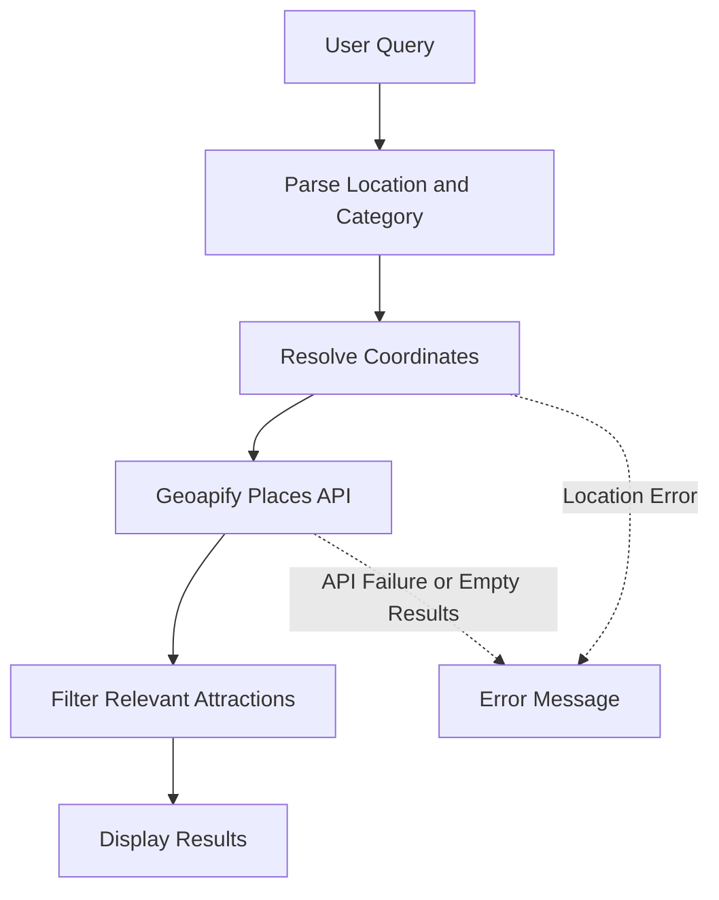

# Tourism Explorer

A HyperDart component for discovering tourist attractions by location and category. Users can enter a destination or search from their current location, then view relevant places returned by Geoapify.

## Features

- Search tourist attractions using natural-language queries.
- Resolve destinations into geographic coordinates.
- Search using the browser's current location.
- Explore museums, temples, forts, parks, monuments, and viewpoints.
- Display attraction cards with available details and map or website links.
- Handle loading, empty-result, location-error, and API-error states.

## Architecture



## How It Works

1. **User query:** The user enters a query such as `museums in Delhi` or `tourist attractions in Paris`.
2. **Parse query:** The component identifies the destination and, where supported, the requested category.
3. **Resolve coordinates:** For a typed destination, Geoapify Geocoding resolves the location. For a current-location search, the browser Geolocation API supplies coordinates after permission is granted.
4. **Fetch places:** The component requests nearby place data from Geoapify Places using coordinates and category parameters.
5. **Filter results:** The component processes place data and applies category matching.
6. **Display results:** Relevant attractions appear as cards, with available details and map or website links.
7. **Handle failures:** The interface shows an appropriate message if location resolution fails, the API request fails, or no relevant results are found.

## Data Sources

**Geoapify Geocoding API**

Converts a typed destination into geographic coordinates.

`https://api.geoapify.com/v1/geocode/search`

**Geoapify Places API**

Retrieves place data based on coordinates and category-related parameters.

`https://api.geoapify.com/v2/places`

**Browser Geolocation API**

Provides the user's current coordinates after browser permission is granted. This is a browser capability, not a Geoapify endpoint.

## Technology Stack

- React
- JavaScript
- Vite
- HyperDart frontend and sandbox packages
- Geoapify Geocoding API
- Geoapify Places API
- Browser Geolocation API
- CSS

## Project Structure

```text
tourism_explorer/
├── hyperdart.config.js
├── searchData.json
├── package.json
├── .env
├── .env.example
└── src/
    ├── frontend/
    │   ├── index.jsx
    │   ├── NewComponent.jsx
    │   └── NewComponent.css
    └── sandbox/
        ├── main.jsx
        └── index.css
```

- `hyperdart.config.js` — HyperDart triggers and configuration.
- `searchData.json` — sandbox test queries, not the live tourism data source.
- `package.json` — dependencies and scripts.
- `src/frontend/index.jsx` — HyperDart `withHD` integration.
- `src/frontend/NewComponent.jsx` — UI, parsing, API requests, and result handling.
- `src/frontend/NewComponent.css` — component styling.
- `src/sandbox/main.jsx` — sandbox entry point.
- `.env` — local environment variables; do not commit.
- `.env.example` — placeholder environment variable template.

## Setup

### Requirements

- Node.js and npm
- A Geoapify API key

### 1. Install Dependencies

```bash
npm install
```

### 2. Configure the API Key

Create a `.env` file in the project root:

```env
VITE_GEOAPIFY_API_KEY=your_actual_api_key
```

Keep `.env` local and exclude it from Git.

The `.env.example` file should contain only a placeholder:

```env
VITE_GEOAPIFY_API_KEY=your_geoapify_api_key_here
```

### 3. Run the Development Server

```bash
npm start
```

Open the local URL printed by Vite. Test typed destinations, category searches, empty results, and current-location behavior. Browser geolocation requires permission and a supported context such as `localhost` or HTTPS.

### 4. Build the Project

```bash
npm run build
```

If configured in the project, run the publishing validation script:

```bash
npm run prepublishOnly
```

## HyperDart Configuration and Publishing

Before publishing:

1. Check trigger keywords and query patterns in `hyperdart.config.js`.
2. Set the correct GitHub repository URL.
3. Add a demo video URL if required by the HyperDart publishing validator.
4. Verify package metadata and registry configuration in `package.json`.
5. Confirm `.env` is excluded from Git and `.env.example` contains only a placeholder.
6. Run the build and publishing validation.
7. Follow the authenticated HyperDart registry publishing workflow.

Publishing guide: https://hyperdart.com/docs/docs/publish/

## Robustness and Limitations

- **Location resolution:** Ambiguous or misspelled destinations may resolve incorrectly.
- **Data coverage:** Geoapify may not have suitable records for every destination or category.
- **Category matching:** Results depend on category mappings and metadata returned by Geoapify.
- **Geolocation:** Current-location search depends on browser support, permission, and hosting restrictions.
- **API failures:** Network problems, invalid keys, provider restrictions, or rate limits can cause requests to fail.
- **Query parsing:** Natural-language handling relies on implemented parsing rules and supported patterns.
- **Third-party data:** Place details and links may be incomplete or outdated.

## Security

The current architecture makes requests to Geoapify directly from the frontend.

Vite variables prefixed with `VITE_` are exposed in client-side code when referenced by the application. Keeping `.env` out of Git prevents accidental repository disclosure, but it does **not** make a frontend API key secret.

- Never commit `.env` or real API keys.
- Keep only a placeholder in `.env.example`.
- Restrict the Geoapify key using provider controls such as allowed origins and usage limits, where available.
- To keep the key confidential, route API requests through a backend or serverless proxy that stores the key server-side.

A backend proxy is not included in the current architecture.

## Evaluation Checklist

- **Design and creativity (25%)** — original interaction and layout that works in sidebar and mainline modes, in light and dark themes.
- **Usefulness and clarity (20%)** — quickly displays useful attractions for the requested destination.
- **Accuracy and relevance (15%)** — relevant tourist places near the correct location.
- **Robustness (15%)** — handles varied destinations, categories, queries, API failures, and empty results.
- **Live review (15%)** — ability to explain the code and make a small change during review.
- **Code quality and README (10%)** — readable implementation, clear documentation, and API-key protection.


